# Data Architecture & Persistence Layer

The supplied `db_employee.sql` dump contains 17 MariaDB/InnoDB tables for employee master data, contact and employment information, OTP authentication, form submissions, and sparse HR-review staging. The application accesses these tables through PHP PDO queries rather than an ORM; the dump is not currently schema-compatible with several application queries.

## Database Configuration

| Service/Module | DB Type | Profile | Driver | Connection | Migration Tool |
|---|---|---|---|---|---|
| Employee form and HR review | MariaDB 10.4.32 in supplied dump | Environment-configured; local `.env` or hosting environment | PDO MySQL | `DB_HOST`, `DB_PORT`, `DB_NAME`, and credentials loaded by `backend-integration/config/database.php` | Versioned SQL scripts in `backend-integration/config/migrations`; schema dump at `backend-integration/config/db_employee.sql` |

All 17 dumped tables use InnoDB. There is no ORM, connection-pool configuration, or application cache identified. The SQL dump includes schema and production-like employee data.

## Data Ownership per Service

| Service | Tables Owned | ORM Framework | Caching | Notes |
|---|---|---|---|---|
| Employee form and HR review | `employees`, `employee_contact`, `employee_employment`, `employee_identification`, `educational_qualifications`, `employee_previous_experience`, `employee_referrals`, `otp_verifications`, `employee_form_submissions`, `form_submission_logs`, and all seven `temp_*` tables | None; PDO and SQL | None found | Employee data is read from HRMS tables; form submissions and changed-field staging are stored in the same database. The requested design stores staged document paths in the existing `temp_*` tables and does not add an `employee_documents` table. |

## Entity Model

The core entity is `employees`, identified by `employee_id`. Contact, employment, identification, education, experience, referral, and OTP records reference it. Submission staging is linked to a submission and employee through composite foreign keys.

```mermaid
erDiagram
    employees ||--o{ employee_contact : "has contact records"
    employees ||--o{ employee_employment : "has employment records"
    employees ||--o{ employee_identification : "has identity records"
    employees ||--o{ educational_qualifications : "has qualifications"
    employees ||--o{ employee_previous_experience : "has experience"
    employees ||--o{ employee_referrals : "has referrals"
    employees ||--o{ otp_verifications : "has OTP records"
    employees ||--o{ employee_form_submissions : "owns submissions"
    employee_form_submissions ||--o{ employee_form_submissions : "is previous submission for"
    employee_form_submissions ||--o{ form_submission_logs : "has audit entries"
    employees ||--o{ form_submission_logs : "has audit entries"
    employee_form_submissions ||--o| temp_employees : "has staged employee changes"
    temp_employees ||--o{ temp_employee_contact : "has staged contact changes"
    temp_employees ||--o{ temp_employee_employment : "has staged employment changes"
    temp_employees ||--o{ temp_employee_identification : "has staged identity changes"
    temp_employees ||--o{ temp_educational_qualifications : "has staged qualifications"
    temp_employees ||--o{ temp_employee_previous_experience : "has staged experience"
    temp_employees ||--o{ temp_employee_referrals : "has staged referrals"
    employees {
        int employee_id PK
        string mss_employee_id
        string working_status
    }
    employee_contact {
        int contact_id PK
        int employee_id FK
        string mobile_no
        string personal_email
    }
    employee_employment {
        int employment_id PK
        int employee_id FK
        string unit
        string branch
        date date_of_joining
    }
    employee_identification {
        int id PK
        int employee_id FK
        string aadhar_no
        string pan_no
    }
    educational_qualifications {
        int id PK
        int employee_id FK
        string qualification_type
        string completion_year
    }
    employee_previous_experience {
        int id PK
        int employee_id FK
        date start_date
        date end_date
    }
    employee_referrals {
        int referral_id PK
        int employee_id FK
        string referred_by
    }
    otp_verifications {
        string mobile PK
        int employee_id FK
        string status
    }
    employee_form_submissions {
        int id PK
        int employee_id FK
        int resubmission_of FK
        string status
    }
    form_submission_logs {
        int id PK
        int submission_id FK
        int employee_id FK
        string action
    }
    temp_employees {
        int temp_row_id PK
        int employee_id FK
        int submission_id FK
    }
    temp_employee_contact {
        int contact_id PK
        int employee_id FK
        int submission_id FK
    }
    temp_employee_employment {
        int employment_id PK
        int employee_id FK
        int submission_id FK
    }
    temp_employee_identification {
        int id PK
        int employee_id FK
        int submission_id FK
    }
    temp_educational_qualifications {
        int id PK
        int employee_id FK
        int submission_id FK
    }
    temp_employee_previous_experience {
        int id PK
        int employee_id FK
        int submission_id FK
    }
    temp_employee_referrals {
        int referral_id PK
        int employee_id FK
        int submission_id FK
    }
```

<!-- mermaid-checked: every attribute is `<type> <name> [<key>] ["<description>"]` with at most one of PK/FK/UK, no \n in descriptions, no {} in descriptions, every relationship label is double-quoted -->

The dump defines 18 foreign-key constraints. Core HR tables reference `employees.employee_id`; the staging tables reference `temp_employees(employee_id, submission_id)`, and `temp_employees` references `employee_form_submissions(employee_id, id)`. This supports employee- and submission-scoped staged changes. Uploaded-file paths can be staged in the existing document-path columns; no separate document registry table is part of the requested design.

## Key Repository Methods

| Service | Repository | Notable Methods | Purpose |
|---|---|---|---|
| Employee form and HR review | `backend-integration/config/hrms-repository.php` | `findHrmsEmployeeIdByMobile(PDO, string)` | Resolve a login mobile to an employee ID. Current implementation queries `employees.mobile_no`; it must be changed to use `employee_contact.mobile_no` for this dump. |
| Employee form and HR review | `backend-integration/config/hrms-repository.php` | `getHrmsEmployeeById(PDO, int)` | Load employee and related contact, employment, identification, and referral fields by employee ID. Several selected columns do not exist in this dump. |
| Employee form and HR review | `backend-integration/config/hrms-repository.php` | `getHrmsEducationRows(PDO, int)`, `getHrmsExperienceRows(PDO, int)`, `getHrmsReferralRows(PDO, int)` | Load related repeatable records by employee ID. |
| Employee form and HR review | `backend-integration/config/hrms-repository.php` | `getHrmsExistingIdentityDocuments(PDO, int)` | Existing master document paths are read from `employee_identification`, `educational_qualifications`, and `employee_previous_experience`. Upload metadata is not stored in a separate document registry. |
| Employee form and HR review | `backend-integration/config/submission-staging.php` | `stageSubmissionRows(PDO, int, int, array)` | Compare submitted values with original rows and stage only changed fields. |
| Employee form and HR review | `backend-integration/api/submit-form.php` | PDO transaction and prepared statements | Persist submission JSON, sparse changed-field staging, and audit log entries. |

## Caching Strategy

No application cache, cache provider, TTL, or cache invalidation strategy was found. Database reads use PDO directly.

## Mobile Login Requirement and Schema Compatibility Review

### Required login and change-staging behavior

1. Resolve the submitted mobile number from `employee_contact.mobile_no`, then join through `employee_contact.employee_id` to `employees.employee_id`.
2. Authenticate only an employee whose `working_status` is exactly `Working`, whose `employee_id` is present, whose `mss_employee_id` is nonblank, and whose contact mobile is valid and unique among eligible employees. Do not authenticate `NA`, blank, malformed, placeholder, or duplicate numbers.
3. Use that single employee ID to load that employee's rows from every related table. Existing foreign keys already express most employee ownership.
4. On submit, persist only changed fields into the corresponding `temp_*` tables. Leave unchanged master-table values alone. After HR approval, apply approved changes to the master tables.

### Confirmed Working-employee login eligibility and HR follow-up

The user confirmed that `working_status = 'Working'` is required, with a present `employee_id` and nonblank `mss_employee_id`. Follow the mobile categories shown in the user's screenshot exactly: `10 DIGIT NUMBER` and `CONTAINS SPACES` are valid mobile types; `NA`, `EMPTY / SPACES ONLY`, `1234567890`, `NOT 10 DIGITS`, and `CONTAINS NON-DIGITS` are invalid and require HR contact. Even a valid-type mobile cannot authenticate if it is duplicated among otherwise eligible employees; that also requires HR resolution.

| Result from supplied dump | Count |
|---|---:|
| Employees with `working_status = 'Working'`, a present `employee_id`, and nonblank `mss_employee_id` | 606 |
| Eligible employees with a valid-format mobile, before duplicate exclusion | 558 |
| Employees blocked because the mobile is invalid, blank, `NA`, or contains disallowed characters | 48 |
| Employees in duplicate-mobile groups, blocked pending HR resolution | 12 |
| Employees with a unique valid mobile and ready for login eligibility | 546 |

Contact HR to confirm or correct the mobile number for these 48 employees. No names are included; use the employee and MSS IDs to locate each record.

| Mobile issue | Employee ID / MSS employee ID |
|---|---|
| `NA` (36) | 1/MSS001, 92/MSS092, 93/MSS093, 96/MSS096, 97/MSS097, 99/MSS099, 123/MSS123, 128/MSS128, 139/MSS139, 144/MSS144, 147/MSS147, 148/MSS148, 183/MSS183, 194/MSS194, 195/MSS195, 215/MSS215, 280/MSS280, 281/MSS281, 282/MSS282, 284/MSS284, 295/MSS295, 298/MSS298, 306/MSS306, 348/MSS348, 452/MSS452, 461/MSS461, 469/MSS469, 470/MSS470, 472/MSS472, 473/MSS473, 474/MSS474, 475/MSS475, 506/MSS506, 563/MSS563, 565/MSS565, 599/MSS599 |
| Blank (6) | 863/MSS801, 865/MSS802, 870/MSS807, 875/MSS812, 878/MSS815, 879/MSS816 |
| Invalid mobile type (6) | 496/MSS496: leading non-breaking space before `9789021141`; 529/MSS529: `95566104369`; 628/MSS619: `-`; 640/MSS631: `95866321494`; 675/MSS669: `917300797275`; 735/MSS702: `915599605` |

These six duplicate groups also require HR action before login. Each row represents two eligible employees with the same ten digits after removing spaces/whitespace; neither employee should authenticate with that number until HR confirms and corrects the authoritative contact record.

| Mobile number | Employee ID / MSS employee ID |
|---|---|
| `7358361646` | 597/MSS597, 808/MSS745 |
| `8682097206` | 435/MSS435, 814/MSS771 |
| `9092843314` | 193/MSS193, 976/MSS902 |
| `9789021141` | 496/MSS496, 511/MSS511 |
| `9840205439` | 269/MSS269, 703/MSS684 |
| `9940947458` | 451/MSS451, 541/MSS541 |

This is a static read of the supplied SQL dump only; no database rows or application code were changed.

## Employee Fetch, Staging, Documents, and HR Approval Flow

Uploaded files are stored under shared category folders using their original filenames. Existing `temp_*` document columns store the filename only; the submission JSON retains a validated relative path for HR review. No document registry table is used.

### 1. Find and authenticate one employee

1. Apply the same mobile-type classification as the supplied screenshot: `10 DIGIT NUMBER` and `CONTAINS SPACES` are valid; every other mobile type is invalid. Reject `1234567890`.
2. Look up `employee_contact.mobile_no`, joined to `employees` on `employee_id`.
3. Keep only rows where `employees.working_status = 'Working'`, `employee_id` is present, and trimmed `mss_employee_id` is not blank.
4. Fetch at most two matches. Authenticate only when exactly one eligible employee has that number. If there are zero matches, tell the employee to contact HR to verify their record. If there are multiple matches, block login and ask HR to resolve the duplicate.
5. Store that `employee_id` in the authenticated session. Use this session identity for every subsequent fetch and write; do not trust a client-supplied employee ID.

The current `findHrmsEmployeeIdByMobile()` does not implement this against the supplied dump: it searches `employees.mobile_no` and accepts both `Working` and `Active`, while this dump stores the mobile in `employee_contact.mobile_no` and the confirmed rule is exactly `Working`.

### 2. Fetch the employee's existing form values

Use the authenticated `employee_id` to read the employee's master row and related rows, always filtering each query by that same ID:

| Form data | Source table(s) |
|---|---|
| Employee number, name, personal details, work status | `employees` |
| Mobile, email, addresses, next-of-kin contact | `employee_contact` |
| Unit, designation, job and employment details | `employee_employment` |
| Aadhaar/PAN values and existing identity-document paths | `employee_identification` |
| Qualifications and certificate paths | `educational_qualifications` |
| Previous jobs and experience-document paths | `employee_previous_experience` |
| Referral and family details | `employee_referrals` |

Return these values to the form as the current baseline. For any table that can contain multiple rows per employee, return the employee's rows in a stable primary-key order. The repository code must use columns that actually exist in this dump; several current prefill selections refer to missing columns, so those mappings must be reconciled before live use.

### 3. Upload files without a document registry

1. Validate file size and actual MIME type in the upload endpoint.
2. Write the file under a server-generated name in the employee-specific temporary directory, for example `employees_temp_documents/aadhar/<employee_id>/<generated-name>.pdf`. Never accept a filesystem path from the browser.
3. Associate the upload with the active draft/submission and the authenticated employee. Store the safe relative path in the corresponding existing staging column:

| Document | Staging table and path column | Master path column on approval |
|---|---|---|
| Aadhaar, PAN, photo, resume, signature, driving, or other identity document | `temp_employee_identification.aadhar_copy`, `pan_copy`, `photo`, `resume`, `staff_sign`, `driving`, `ccs`, `others`, or `pg_degree_doc` as applicable | Matching column in `employee_identification` |
| Education certificate | `temp_educational_qualifications.certificate_path` | `educational_qualifications.certificate_path` |
| Experience pay slip or letter | `temp_employee_previous_experience.pay_slip` or `experience_letter_path` | Matching column in `employee_previous_experience` |

4. Return only an upload reference that is bound to the employee and active submission. At final submission, resolve and validate that reference server-side, then persist the validated relative path in the appropriate temp-table row. If upload-time temp rows are written directly, create the draft submission and required parent temp row first.
5. HR preview/download must resolve paths from the submission's `temp_*` rows, check that the path is inside the expected employee temporary directory, and never expose an arbitrary client path.

The supplied dump already has these document-path columns in the staging tables. It does not have a document metadata table, so names, MIME types, and file sizes are not database-indexed separately in this design. If those metadata become required, add columns to the relevant staging rows rather than introducing a separate registry table, subject to confirming the existing application requirements.

### 4. Submit changed data to the existing temp tables

1. Validate the submitted form and resolve all file references to server-verified paths.
2. Start a database transaction, lock/check the employee row, prevent a second pending submission, and create or reuse an `employee_form_submissions` record with the employee ID and status `pending`.
3. Compare submitted scalar values to the employee's current master values. Insert only changed values into the corresponding table:
   - `temp_employees` for changed personal fields;
   - `temp_employee_contact` for changed contact/address/next-of-kin fields;
   - `temp_employee_identification` for changed identity fields and new document paths;
   - `temp_employee_employment` for changed employment fields;
   - `temp_employee_referrals` for changed referral/family rows;
   - `temp_educational_qualifications` for a changed qualification collection;
   - `temp_employee_previous_experience` for a changed experience collection.
4. For repeatable collections, compare the submitted collection as a whole. If changed, stage the proposed final collection under the same employee and submission IDs; do not touch the live collection before approval. An unchanged collection should not be staged.
5. Keep original/master rows unchanged while HR review is pending. Record changed-field names, original-value snapshots, and the submit action in `employee_form_submissions` and `form_submission_logs`.
6. Commit the staging rows and pending submission together. If any database write fails, roll back the transaction and return an error rather than reporting success.

**Important temp-table parent rule:** every `temp_*` child row has a composite foreign key to `temp_employees(employee_id, submission_id)`, and `temp_employees` references the matching `(employee_id, id)` in `employee_form_submissions`. Therefore create a `temp_employees` parent/anchor row for every submission that has any staged changes, even when no field in the `employees` master row changed. The current staging function inserts that row only when employee fields changed; child-only submissions can therefore fail their foreign-key constraint. Ensure that anchor row exists before inserting child rows.

The current staging function does not stage `employee_employment` fields, despite the existence of `temp_employee_employment` and approval mappings. Add and test the employment comparison/staging path if those fields are in the requested editable scope.

### 5. HR review, approval, and rejection

1. HR loads the pending `employee_form_submissions` item and reads staged rows using both `employee_id` and `submission_id`.
2. The review UI compares staged values with the stored original-value snapshots. HR can approve or reject the submission or supported individual changed fields.
3. For approval, within a transaction, apply only approved scalar fields to their matching master table. For an approved changed collection, replace that employee's master collection with the staged final collection.
4. For each approved temporary document path, validate the employee/type-specific temporary path, move the file to the employee's permanent file directory, and write the permanent relative path into the corresponding master-table document column. If database promotion fails, roll back database changes and remove any newly copied permanent files. After commit, remove the temporary copy.
5. Update submission status, reviewer identity, approval time, approved-field list, and audit log. Rejection changes submission/review state only; it must not alter employee master rows. Rejected or abandoned temporary files require a documented cleanup policy.

### Document workflow implementation status

- Uploads do not insert into `employee_documents`. The upload endpoint returns a signed, session-bound reference, which the serializer resolves to a safe temporary path.
- The existing `temp_*` document fields receive filename-only values. HR preview and approval use submission paths; approval promotes the file and updates the existing master document columns.
- The runtime PHP and JavaScript no longer query `employee_documents`; no table or database migration is required for this workflow.
- The mobile lookup must use `employee_contact.mobile_no`, exact `Working`, nonblank MSS ID, valid format, and unique eligible match.
- The staging parent row must be inserted for child-only changes, and employment values must be staged if they are editable.

This assessment originally identified the missing-table issue. The PHP flow has since been updated to use the existing staging and master tables. No live database rows were changed; validate the updated approval flow against the deployed schema before production use.

### Dump findings and required decisions

| Area | Finding in supplied dump | Recommended action |
|---|---|---|
| Active status | There are 975 employee rows. Status values include `Working` (608), `Resigned` (173), `Terminated` (26), `GE` (68), `Deleted` (13), `Duplicate` (10), `Rejected` (4), `Cancelled` (1), `Marked Resignation` (2), `Marked Termination` (1), and blank (69). No row uses the literal value `Active`. The user confirmed that login eligibility must use `working_status = 'Working'`. | Filter login candidates by the exact `Working` value; do not treat `GE` or other statuses as eligible. |
| MSS employee ID | `mss_employee_id` is `NOT NULL`, but 83 records contain a blank value; two `Working` rows have blank MSS IDs. No duplicate nonblank MSS IDs were found in this dump. | Correct the blank values and add a unique index if MSS IDs are meant to be unique. Keep login eligibility guarded by a nonblank ID until cleanup is complete. |
| Contact mobiles | The user-provided mobile classification shows 975 rows: 441 ten-digit values without spaces, 417 values containing spaces, 73 `NA`, 19 empty/spaces-only, 18 placeholders `1234567890`, six values that are not ten digits, and one value containing non-digit characters. The `mobile_no` column is `NOT NULL` and has no index or uniqueness constraint. | Remove spaces/whitespace only for validation and comparison; require exactly ten digits, reject `1234567890`, and treat `NA`, blanks, malformed values, and duplicates as HR follow-up. Resolve shared numbers before adding a unique constraint. |
| Duplicate mobile values | There are duplicate values across employee statuses; six duplicate numbers affect employees with `working_status = 'Working'` and nonblank MSS IDs. | Resolve the six login-eligible collisions first; do not allow any collided number to authenticate until the correct employee is unambiguous. Full duplicate listing is below. |
| Employee lookup | The dump has `mobile_no` in `employee_contact`, not `employees` or `employee_employment`. Current application lookup uses `employees.mobile_no`. | This is an application query change, not a need to duplicate mobile numbers into `employees`. Query contact mobile and join to `employees`, with exact status/MSS filters and unique-number enforcement. |
| Employee prefill | `employee_contact` lacks `pincode`, `city`, `state`, `country`, and corresponding `perm_*` columns expected by current repository queries. `employee_identification` lacks `aadharlinked`, `pg_degree_status`, and `pg_degree_institution`; `aadharlinked` is in `employee_contact`. The application also expects mobile columns in `employees` or `employee_employment`, which are absent. | Reconcile source data and decide column mappings. Update repository queries to actual columns where equivalent data exists; add/backfill columns only when the authoritative values exist and are needed. Do not fabricate address or education data. |
| Document uploads | No `employee_documents` table exists in the dump. Existing `temp_employee_identification`, `temp_educational_qualifications`, and `temp_employee_previous_experience` tables contain document-path columns. | Do not create a document registry. Store files by original filename under the shared category folder; stage filename-only values in existing temp-table columns, then promote approved files and update master paths during HR approval. |
| Staging and approvals | All seven `temp_*` tables exist and have submission-scoped foreign keys. The dump has employee form submissions and audit logs. | This structure supports sparse, employee-scoped staging. Keep the application’s changed-field comparison and transactional approval path; test it against this exact schema before deployment. |
| Redundant indexes | `employee_form_submissions` has two equivalent unique keys on `(employee_id, id)`. | Keep one of the duplicate unique indexes after checking deployed constraints. |

### Duplicate mobile numbers

Numbers below are normalized to ten digits. The employee IDs and status labels are included to support matching records during cleanup; no names or other personal fields are included. Duplicate groups include all statuses.

| Mobile number | Employee IDs and statuses |
|---|---|
| `6380605611` | 849 (Duplicate); 858 (Resigned) |
| `6381907893` | 946 (blank); 955 (Working) |
| `6383674297` | 318 (Resigned); 705 (Working) |
| `7200955627` | 308 (Resigned); 970 (blank) |
| `7358361646` | 597 (Working); 808 (Working) |
| `7358606995` | 212 (Terminated); 695 (blank); 699 (blank); 712 (Working) |
| `7397292722` | 904 (blank); 905 (blank); 912 (Working) |
| `7867804478` | 985 (blank); 986 (blank) |
| `8190921908` | 656 (Rejected); 665 (Working) |
| `8220687443` | 805 (Resigned); 954 (Working) |
| `8270099131` | 921 (blank); 922 (Working) |
| `8667316567` | 590 (Resigned); 951 (Working) |
| `8682097206` | 435 (Working); 814 (Working) |
| `8939258405` | 460 (Resigned); 907 (blank); 909 (Working) |
| `8939525869` | 717 (blank); 744 (Working) |
| `9003094045` | 788 (blank); 790 (blank); 791 (Working) |
| `9003122405` | 617 (Working); 813 (blank) |
| `9042799841` | 692 (Cancelled); 743 (Working) |
| `9092843314` | 193 (Working); 976 (Working) |
| `9094511913` | 214 (Terminated); 696 (blank); 698 (Working) |
| `9176109980` | 255 (GE); 751 (Resigned) |
| `9361533077` | 644 (Working); 645 (Resigned) |
| `9384651109` | 855 (blank); 856 (Working) |
| `9444249249` | 204 (Terminated); 702 (Resigned) |
| `9444804259` | 103 (Resigned); 892 (Working) |
| `9445012617` | 674 (Duplicate); 684 (Working) |
| `9445050470` | 723 (blank); 753 (blank); 756 (Working) |
| `9445729301` | 217 (GE); 935 (Working) |
| `9500081789` | 686 (blank); 687 (Rejected); 704 (Resigned) |
| `9566014189` | 61 (Resigned); 853 (Working) |
| `9566278150` | 62 (Resigned); 918 (Working) |
| `9600013859` | 740 (blank); 741 (Deleted); 762 (blank) |
| `9787932245` | 747 (blank); 748 (Resigned) |
| `9789021141` | 496 (Working); 511 (Working) |
| `9790705385` | 350 (Resigned); 729 (Working) |
| `9791119702` | 772 (blank); 774 (Working) |
| `9840205439` | 269 (Working); 303 (Terminated); 701 (blank); 703 (Working) |
| `9840878764` | 152 (Resigned); 737 (Working) |
| `9884077113` | 187 (Resigned); 968 (Working) |
| `9884417763` | 581 (Duplicate); 585 (Working) |
| `9940947458` | 451 (Working); 541 (Working) |
| `9941088207` | 819 (blank); 859 (Working) |
| `9941527907` | 462 (Terminated); 697 (Working) |
| `9941577844` | 745 (blank); 786 (Resigned) |
| `9952852935` | 752 (blank); 787 (Working) |
| `9987150555` | 593 (Resigned); 932 (Working) |

The six collisions involving only `Working` employees with nonblank MSS IDs are `7358361646` (597/MSS597, 808/MSS745), `8682097206` (435/MSS435, 814/MSS771), `9092843314` (193/MSS193, 976/MSS902), `9789021141` (496/MSS496, 511/MSS511), `9840205439` (269/MSS269, 703/MSS684), and `9940947458` (451/MSS451, 541/MSS541). Compare exact ten-digit values after removing spaces/whitespace, not merely the last ten digits of longer values. Since `Working` is the confirmed eligibility status, these are immediate login blockers until HR resolves each collision.

## Data Ownership Boundaries

All employee, submission, review, OTP, and staging data resides in one shared MariaDB database. The PHP application directly queries the HRMS-owned employee tables and writes form submissions and sparse changes to the same database; no service-to-service API boundary or CQRS read store was identified.

### Data Classification & Sensitivity

| Entity | Sensitive Fields | Classification (PII/PHI/PCI/None) | Controls in Place |
|---|---|---|---|
| `employees` | Names, birth dates, family names, gender, marital status | PII | No field-level encryption or masking identified in the dump. |
| `employee_contact` | Mobile numbers, email, home addresses, NOK details | PII | No field-level encryption or masking identified in the dump. |
| `employee_identification` | Aadhaar and PAN numbers; document paths | PII | No field-level encryption or masking identified in the dump. |
| `educational_qualifications` | Education and certificate paths | PII | No field-level encryption or masking identified in the dump. |
| `employee_employment` | Employment and work-history details | PII | No field-level encryption or masking identified in the dump. |
| `employee_form_submissions` | Full serialized form snapshots and reviewer notes | PII | Submission status and reviewer metadata are stored; field-level encryption or masking was not identified. |
| `otp_verifications` | Mobile number and plain-text OTP value | PII and authentication secret | OTP values are stored in clear text in this dump; clear active OTPs and do not distribute data dumps containing them. |
| `form_submission_logs` | Employee ID, actor, IP address, user agent, notes | PII | No masking identified in the dump. |

No PHI or PCI fields were identified. The dump contains employee PII including names, addresses, mobile numbers, email, Aadhaar/PAN values, family contacts, employment records, and uploaded-document paths. No encryption-at-rest, field-level masking, or encryption of PII fields is defined in the schema dump. Restrict access to the SQL file and remove active OTP rows from any dump used outside the live environment.
